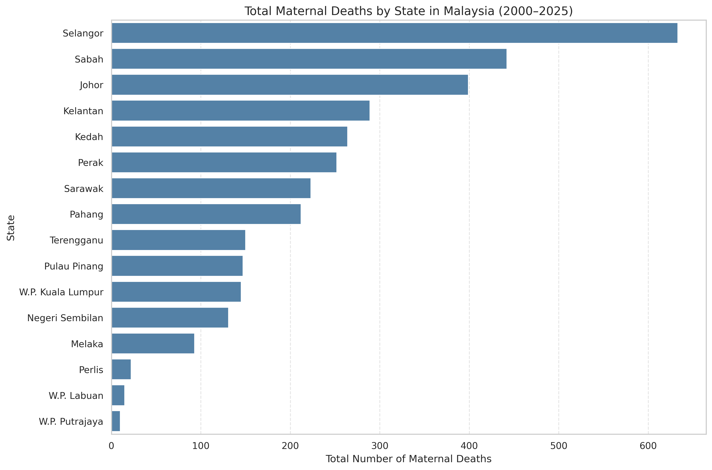
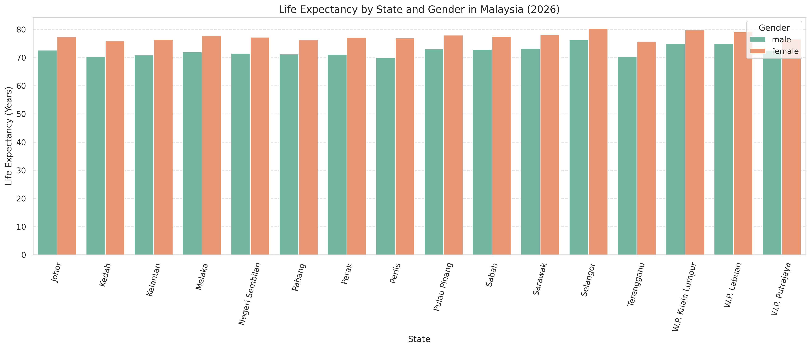
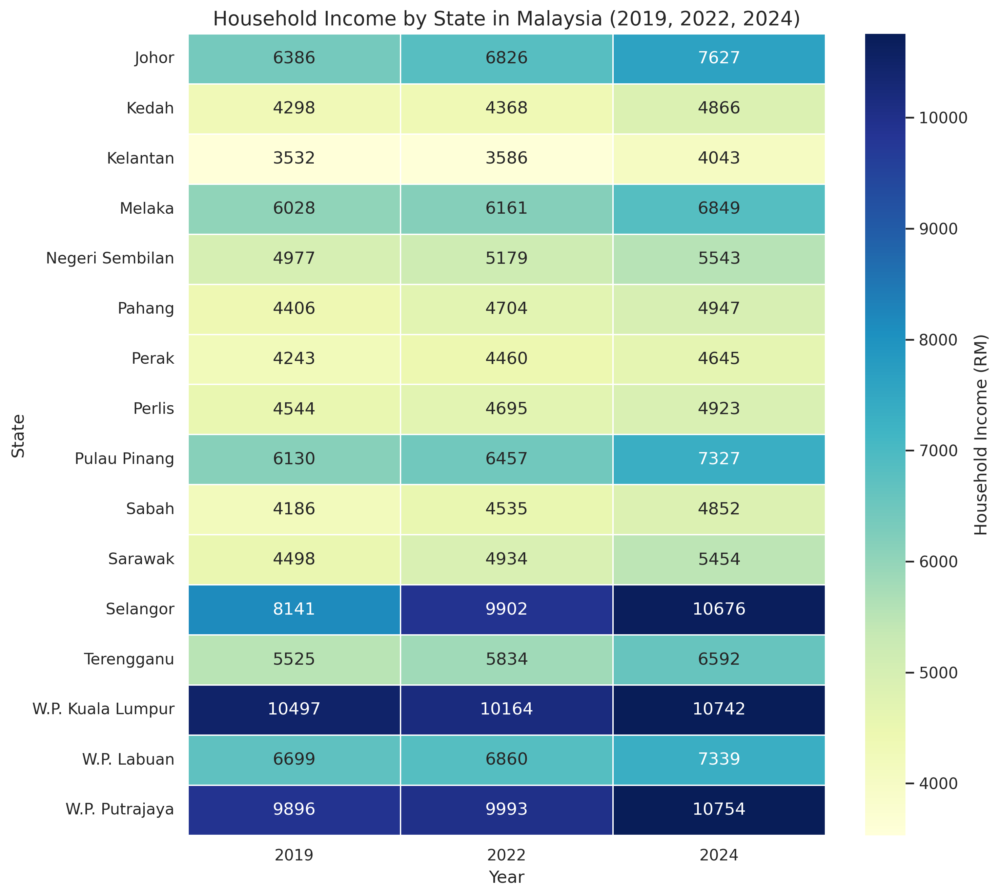

# Scientific Visualisation of Malaysian Socioeconomic and Health Data

## Project Overview

This project focuses on analysing and visualising Malaysian socioeconomic and health data using Python and Google Colab.

The analysis explores three key areas:
- Maternal deaths in Malaysia (2000–2025)
- Life expectancy across Malaysian states (2022–2026)
- Household income distribution in Malaysia (2019, 2022 and 2024)

The project uses data visualisation techniques to identify trends, compare patterns across states, and present statistical information in a clear and understandable format.

## Project Objectives

1. To analyse maternal death trends across Malaysian states.
2. To examine life expectancy differences by state, gender and ethnicity.
3. To explore household income distributions and differences across Malaysian states.
4. To communicate findings through statistical charts and visualisations.

## Tools and Technologies

- **Python** – Data analysis and visualisation
- **Google Colab** – Development environment
- **Pandas** – Data manipulation and analysis
- **NumPy** – Numerical operations
- **Matplotlib** – Data visualisation
- **Seaborn** – Statistical visualisation
- **GitHub** – Project documentation and version control

## Datasets

The project uses three main datasets:

| Dataset | Description |
|---|---|
| `death_maternal_state.csv` | Maternal death statistics by Malaysian state |
| `life_expectancy_state_ethnic.csv` | Life expectancy statistics by state and ethnicity |
| `hies_state_percentile.csv` | Household income distribution by state and percentile |

The datasets are stored in the `datasets/` directory.

## Data Visualisations

### 1. Maternal Death Analysis

This section explores maternal death statistics across Malaysian states from 2000 to 2025.

Visualisations include:
- Total Maternal Deaths by State
- Maternal Death Trends
- Maternal Death Rates Heatmap



### 2. Life Expectancy Analysis

This section examines life expectancy patterns across Malaysian states, including gender and ethnic group comparisons.

Visualisations include:
- Life Expectancy by State and Gender (2026)
- Life Expectancy Distribution by Ethnic Group (2026)
- Life Expectancy Trends Across States (2022–2026)



### 3. Household Income Analysis

This section explores household income patterns and income differences across Malaysian states.

Visualisations include:
- Household Income at the 50th Percentile (2024)
- Household Income Heatmap (2019, 2022 and 2024)
- Household Income Across Percentiles (2024)



## Project Structure

```text
Scientific_Visualisation/
│
├── datasets/
│   ├── death_maternal_state.csv
│   ├── hies_state_percentile.csv
│   ├── life_expectancy_state_ethnic.csv
│   ├── maternal_summary.csv
│   ├── life_expectancy_summary.csv
│   └── household_income_summary.csv
│
├── notebooks/
│   └── Scientific_Visualisation.ipynb
│
├── visualizations/
│   ├── maternal_death/
│   ├── life_expectancy/
│   └── household_income/
│
└── README.md
```

## Methodology

The project follows a data analysis and visualisation workflow:

1. **Data Collection** – Prepare the datasets for analysis.
2. **Data Exploration** – Examine dataset structures, variables and statistical patterns.
3. **Data Analysis** – Calculate relevant statistics and compare observations.
4. **Data Visualisation** – Generate charts using Matplotlib and Seaborn.
5. **Results Presentation** – Organise charts and summary datasets for interpretation.

## Google Colab Notebook

All three datasets and their visualisations were analysed using a single Google Colab notebook.

**Notebook:** [`Scientific_Visualisation.ipynb`](notebooks/Scientific_Visualisation.ipynb)

The notebook contains Python code for data analysis, statistical summaries and visualisation.

## Skills Demonstrated

- Python Programming
- Data Analysis
- Data Visualisation
- Exploratory Data Analysis
- Statistical Summarisation
- Data Interpretation
- Project Organisation
- GitHub Version Control

## Conclusion

This project demonstrates the application of Python-based data analysis and visualisation techniques to Malaysian socioeconomic and health datasets.

By presenting maternal death statistics, life expectancy patterns and household income distributions through visualisations, the project supports a clearer understanding of differences and trends across Malaysian states.
